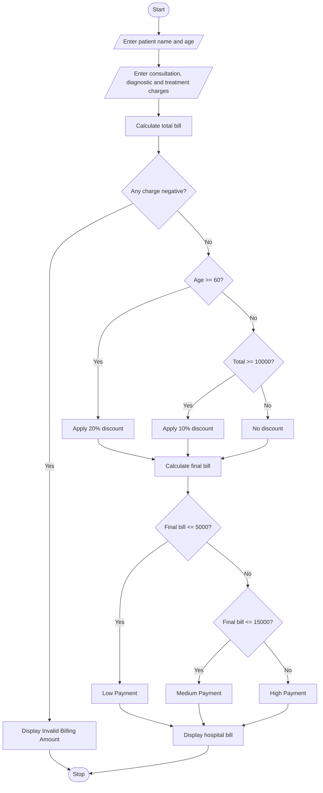

# 1. Problem Statement
Write a Python program to calculate a hospital bill using consultation, diagnostic, and treatment charges. Apply conditional concessions based on patient age and total bill amount. Validate billing constraints and classify patients into Low, Medium, or High Payment categories according to the payment policy.
# 2. Algorithm
1. Start the program.
2. Read the patient name and age.
3. Enter consultation, diagnostic, and treatment charges.
4. Calculate the total bill.
5. Check whether the charges are negative.
6. If the patient age is 60 or above, apply a 20% discount.
7. Otherwise, if the total bill is ₹10,000 or above, apply a 10% discount.
8. Otherwise, no discount is applied.
9. Calculate the final bill after discount.
10. Classify the patient:
    - Up to ₹5,000 – Low Payment.
    - ₹5,001 to ₹15,000 – Medium Payment.
    - Above ₹15,000 – High Payment.
11. Display the patient details, total bill, discount, and final bill.
12. Stop the program.
# 3. Flowchart (Mermaid)

# 4. Source Code (Python)

# Hospital Billing and Patient Classification

# Input patient details
name = input("Enter patient name: ")
age = int(input("Enter patient age: "))

# Input hospital charges
consultation = float(input("Enter consultation charge: "))
diagnostic = float(input("Enter diagnostic charge: "))
treatment = float(input("Enter treatment charge: "))

# Calculate total bill
total = consultation + diagnostic + treatment

# Validate billing constraints
if consultation < 0 or diagnostic < 0 or treatment < 0:
    print("Invalid billing amount!")

else:
    # Apply concession
    if age >= 60:
        discount = total * 0.20
        print("20% senior citizen concession applied")

    elif total >= 10000:
        discount = total * 0.10
        print("10% concession applied")

    else:
        discount = 0
        print("No concession applied")

    # Calculate final bill
    final_bill = total - discount

    # Patient classification
    if final_bill <= 5000:
        category = "Low Payment"

    elif final_bill <= 15000:
        category = "Medium Payment"

    else:
        category = "High Payment"

    # Display bill
    print("\n------ HOSPITAL BILL ------")
    print("Patient Name:", name)
    print("Patient Age:", age)
    print("Consultation Charge:", consultation)
    print("Diagnostic Charge:", diagnostic)
    print("Treatment Charge:", treatment)
    print("Total Bill:", total)
    print("Discount:", discount)
    print("Final Bill:", final_bill)
    print("Patient Classification:", category)
# 5. Input
Enter patient name: Ravi
Enter patient age: 65
Enter consultation charge: 1000
Enter diagnostic charge: 2000
Enter treatment charge: 5000
# 6. Output
20% senior citizen concession applied

------ HOSPITAL BILL ------
Patient Name: Ravi
Patient Age: 65
Consultation Charge: 1000.0
Diagnostic Charge: 2000.0
Treatment Charge: 5000.0
Total Bill: 8000.0
Discount: 1600.0
Final Bill: 6400.0
Patient Classification: Medium Payment
# 7. Output Screenshot

