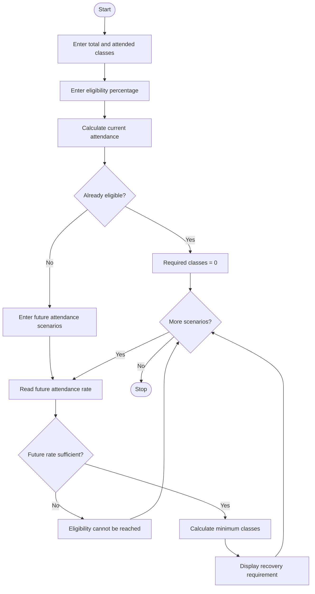

# 1. Problem Statement
Write a Python program to calculate a student's current attendance percentage and determine the minimum number of consecutive classes required to reach a specified attendance eligibility threshold. Consider different future attendance scenarios and display the required number of classes for each scenario.
# 2. Algorithm
1. Start the program.
2. Enter total classes conducted.
3. Enter the number of classes attended.
4. Enter the required attendance percentage.
5. Calculate current attendance percentage.
6. Check whether the student has already reached the eligibility threshold.
7. Enter the number of future attendance scenarios.
8. For each scenario, enter the expected future attendance percentage.
9. Calculate the minimum future classes required.
10. If the expected future attendance rate is insufficient, display that eligibility cannot be achieved under that scenario.
11. Display the current attendance and recovery requirements.
12. Stop.
# 3. Mermaid Flowchart

# 4. Python Source Code

print("ATTENDANCE RECOVERY COMPUTATION")
print("--------------------------------")

total = int(input("Enter total classes conducted: "))
attended = int(input("Enter classes attended: "))
threshold = float(input("Enter eligibility percentage: "))

if total <= 0 or attended < 0 or attended > total:
    print("Invalid attendance details")
    raise SystemExit

if not 0 < threshold <= 100:
    print("Invalid eligibility percentage")
    raise SystemExit

current = (attended / total) * 100

print("\nCurrent Attendance:", round(current, 2), "%")

if current >= threshold:
    print("Status: Eligible")
    print("Additional classes required: 0")
else:
    print("Status: Not Eligible")

n = int(input("\nEnter number of future scenarios: "))

for i in range(n):
    rate = float(input(
        "\nEnter future attendance rate (%): "
    ))

    if not 0 <= rate <= 100:
        print("Invalid future attendance rate")
        continue

    if current >= threshold:
        print("Already eligible. Required classes: 0")

    elif rate < threshold:
        print("Eligibility cannot be reached")
        print("under this future attendance scenario.")

    else:
        classes = 0

        while True:
            future_attended = (classes * rate) // 100
            percentage = (
                (attended + future_attended) /
                (total + classes)
            ) * 100

            if percentage >= threshold:
                break

            classes += 1

        print("Minimum future classes required:", classes)
        print("Expected final attendance:",
              round(percentage, 2), "%")

print("\nAttendance calculation completed.")
# 5. Sample Input
Enter total classes conducted: 100
Enter classes attended: 65
Enter eligibility percentage: 75

Enter number of future scenarios: 3

Enter future attendance rate (%): 100
Enter future attendance rate (%): 90
Enter future attendance rate (%): 80
# 6.Expected output
ATTENDANCE RECOVERY COMPUTATION
--------------------------------

Current Attendance: 65.0 %
Status: Not Eligible

Future attendance rate: 100%
Minimum future classes required: 40
Expected final attendance: 75.0 %

Future attendance rate: 90%
Minimum future classes required: 68
Expected final attendance: 75.0 %

Future attendance rate: 80%
Minimum future classes required: 200
Expected final attendance: 75.0 %

Attendance calculation completed.
# 7.Output screenshot
