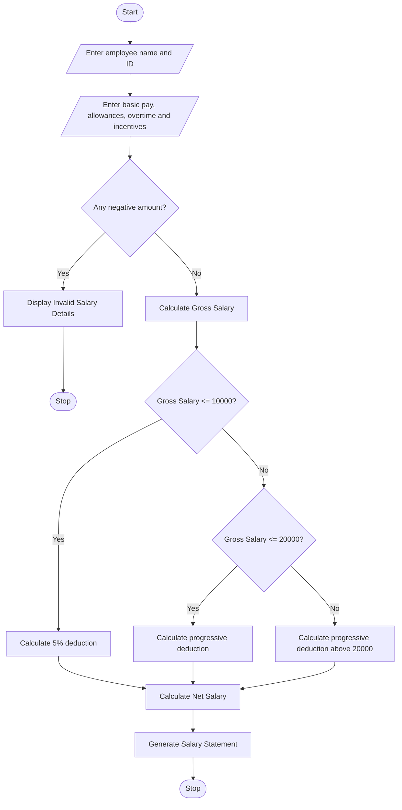

# 1. Problem Statement
Write a Python program to calculate an employee's gross salary using basic pay, allowances, overtime, and incentives. Apply progressive deductions based on the salary amount and calculate the net salary. Finally, generate a formatted salary statement displaying employee details, gross salary, deductions, and net salary.
# 2. Algorithm
1. Start the program.
2. Enter employee name and employee ID.
3. Enter basic pay, allowances, overtime, and incentives.
4. Calculate gross salary by adding all earnings.
5. Validate the salary details to ensure that no amount is negative.
6. Apply progressive deductions:
   - If gross salary is up to ₹10,000, deduct 5%.
   - If gross salary is between ₹10,001 and ₹20,000, deduct 10%.
   - If gross salary is above ₹20,000, deduct 15%.
7. Calculate net salary by subtracting deductions from gross salary.
8. Display the formatted salary statement.
9. Stop the program.
# 3. Flowchart (Mermaid)

# 4. Source Code (Python)

# Employee Payroll and Deduction Analysis

# Input employee details
name = input("Enter employee name: ")
emp_id = input("Enter employee ID: ")

# Input salary details
basic = float(input("Enter basic pay: "))
allowances = float(input("Enter allowances: "))
overtime = float(input("Enter overtime amount: "))
incentives = float(input("Enter incentives: "))

# Validate salary details
if basic < 0 or allowances < 0 or overtime < 0 or incentives < 0:
    print("Invalid salary details!")

else:
    # Calculate gross salary
    gross = basic + allowances + overtime + incentives

    # Calculate progressive deductions
    if gross <= 10000:
        deduction = gross * 0.05

    elif gross <= 20000:
        deduction = (10000 * 0.05) + ((gross - 10000) * 0.10)

    else:
        deduction = (10000 * 0.05) + (10000 * 0.10) + ((gross - 20000) * 0.15)

    # Calculate net salary
    net_salary = gross - deduction

    # Display salary statement
    print("\n====== EMPLOYEE SALARY STATEMENT ======")
    print("Employee Name :", name)
    print("Employee ID   :", emp_id)
    print("---------------------------------------")
    print("Basic Pay     : Rs.", basic)
    print("Allowances    : Rs.", allowances)
    print("Overtime      : Rs.", overtime)
    print("Incentives    : Rs.", incentives)
    print("---------------------------------------")
    print("Gross Salary  : Rs.", gross)
    print("Deductions    : Rs.", deduction)
    print("Net Salary    : Rs.", net_salary)
    print("=======================================")
# 5. Input
Enter employee name: Ravi
Enter employee ID: E101
Enter basic pay: 15000
Enter allowances: 3000
Enter overtime amount: 2000
Enter incentives: 1000
# 6. Output
====== EMPLOYEE SALARY STATEMENT ======
Employee Name : Ravi
Employee ID   : E101
---------------------------------------
Basic Pay     : Rs. 15000.0
Allowances    : Rs. 3000.0
Overtime      : Rs. 2000.0
Incentives    : Rs. 1000.0
---------------------------------------
Gross Salary  : Rs. 21000.0
Deductions    : Rs. 1650.0
Net Salary    : Rs. 19350.0
=======================================
# 7. Output Screenshot

