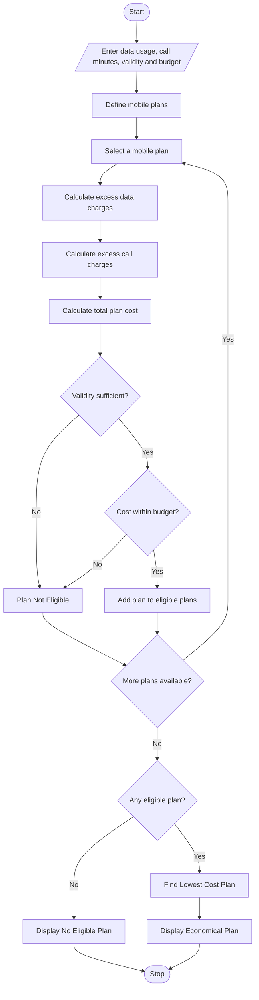

# 1. Problem Statement
Write a Python program to compare multiple mobile recharge plans based on data usage, call usage, validity, and budget. Calculate excess data and call charges for each plan, check whether the plan satisfies the user's requirements, and identify the most economical eligible plan.
# 2. Algorithm
1. Start the program.
2. Enter required data usage in GB.
3. Enter required call minutes.
4. Enter required validity in days.
5. Enter the maximum budget.
6. Define multiple mobile plans with price, data limit, call limit, validity, and excess charges.
7. Calculate excess data and call charges for each plan.
8. Calculate the total cost of each plan.
9. Check whether each plan satisfies the validity and budget constraints.
10. Identify the eligible plan with the lowest total cost.
11. Display all plan details and the most economical plan.
12. Stop the program.
# 3. Flowchart (Mermaid)

# 4. Source Code (Python)

# Multi-Plan Telecommunications Cost Optimization

# Mobile plan details
plans = [
    {
        "name": "Basic Plan",
        "price": 149,
        "data": 2,
        "calls": 100,
        "validity": 28,
        "data_charge": 20,
        "call_charge": 1
    },
    {
        "name": "Standard Plan",
        "price": 299,
        "data": 5,
        "calls": 300,
        "validity": 56,
        "data_charge": 15,
        "call_charge": 0.75
    },
    {
        "name": "Premium Plan",
        "price": 499,
        "data": 10,
        "calls": 600,
        "validity": 84,
        "data_charge": 10,
        "call_charge": 0.50
    }
]

# Get user requirements
data_used = float(input("Enter required data usage (GB): "))
calls_used = float(input("Enter required call minutes: "))
days = int(input("Enter required validity (days): "))
budget = float(input("Enter your budget (Rs.): "))

# Validate input
if data_used < 0 or calls_used < 0 or days < 0 or budget < 0:
    print("Invalid input! Values cannot be negative.")

else:
    eligible_plans = []

    print("\n------ PLAN COMPARISON ------")

    # Evaluate each plan
    for plan in plans:

        excess_data = max(0, data_used - plan["data"])
        excess_calls = max(0, calls_used - plan["calls"])

        data_cost = excess_data * plan["data_charge"]
        call_cost = excess_calls * plan["call_charge"]

        total_cost = plan["price"] + data_cost + call_cost

        print("\nPlan:", plan["name"])
        print("Base Price: Rs.", plan["price"])
        print("Excess Data Charge: Rs.", data_cost)
        print("Excess Call Charge: Rs.", call_cost)
        print("Total Cost: Rs.", round(total_cost, 2))

        # Check eligibility
        if plan["validity"] >= days and total_cost <= budget:
            eligible_plans.append((total_cost, plan["name"]))
            print("Status: Eligible")
        else:
            print("Status: Not Eligible")

    # Find economical plan
    print("\n------ FINAL RESULT ------")

    if eligible_plans:
        best = min(eligible_plans)

        print("Most Economical Plan:", best[1])
        print("Total Cost: Rs.", round(best[0], 2))
    else:
        print("No eligible plan found within your budget.")
# 5. Input
Enter required data usage (GB): 4
Enter required call minutes: 250
Enter required validity (days): 28
Enter your budget (Rs.): 350
# 6. Output
------ PLAN COMPARISON ------

Plan: Basic Plan
Base Price: Rs. 149
Excess Data Charge: Rs. 40.0
Excess Call Charge: Rs. 150.0
Total Cost: Rs. 339.0
Status: Eligible

Plan: Standard Plan
Base Price: Rs. 299
Excess Data Charge: Rs. 0
Excess Call Charge: Rs. 0
Total Cost: Rs. 299
Status: Eligible

Plan: Premium Plan
Base Price: Rs. 499
Excess Data Charge: Rs. 0
Excess Call Charge: Rs. 0
Total Cost: Rs. 499
Status: Not Eligible

------ FINAL RESULT ------
Most Economical Plan: Standard Plan
Total Cost: Rs. 299
# 7. Output Screenshot

