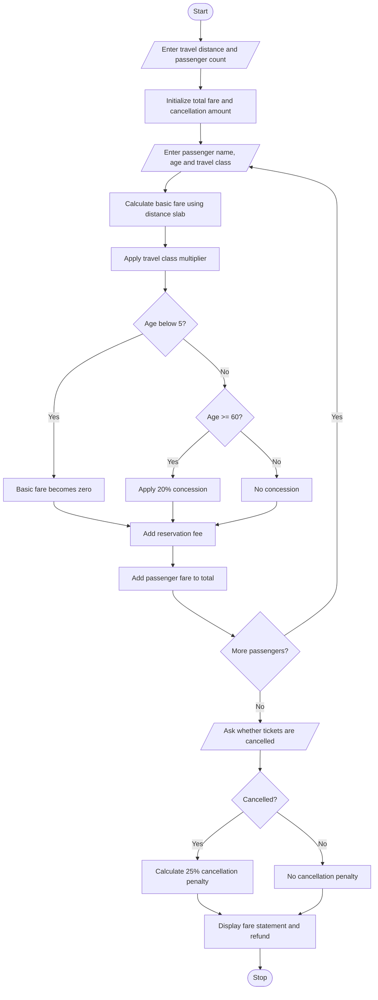

# 1. Problem Statement
Write a Python program to calculate railway ticket fares for multiple passengers based on travel distance, travel class, and age-based concessions. Add reservation fees and calculate cancellation penalties when tickets are cancelled. Finally, display a detailed fare statement showing the total ticket cost and cancellation charges.
# 2. Algorithm
1. Start the program.
2. Enter the travel distance in kilometres.
3. Enter the number of passengers.
4. For each passenger:
   - Enter passenger name and age.
   - Select travel class (Sleeper, AC 3 Tier, or AC 2 Tier).
5. Calculate the basic fare based on distance slabs:
   - Up to 100 km – ₹1 per km.
   - 101–500 km – ₹1.5 per km.
   - Above 500 km – ₹2 per km.
6. Calculate the fare according to the selected travel class:
   - Sleeper – 1 times basic fare.
   - AC 3 Tier – 2 times basic fare.
   - AC 2 Tier – 3 times basic fare.
7. Apply age-based concessions:
   - Below 5 years – Free.
   - 60 years and above – 20% concession.
   - Others – No concession.
8. Add a reservation fee of ₹40 per passenger.
9. Calculate the total fare for all passengers.
10. Ask whether the tickets are cancelled.
11. If cancelled, apply a 25% cancellation penalty on the ticket fare before reservation fees.
12. Display the final reservation or cancellation statement.
13. Stop the program.
# 3. Flowchart (Mermaid)

# 4. Source Code (Python)

# Railway Fare and Reservation Calculator

# Input journey details
distance = float(input("Enter travel distance (km): "))
n = int(input("Enter number of passengers: "))

# Validate journey details
if distance <= 0 or n <= 0:
    print("Invalid distance or passenger count!")

else:
    total_fare = 0
    total_ticket_fare = 0

    for i in range(n):
        print("\nPassenger", i + 1)

        name = input("Enter passenger name: ")
        age = int(input("Enter passenger age: "))

        travel_class = input(
            "Enter class (Sleeper/AC3/AC2): "
        ).upper()

        # Distance slab rate
        if distance <= 100:
            rate = 1
        elif distance <= 500:
            rate = 1.5
        else:
            rate = 2

        # Class multiplier
        if travel_class == "SLEEPER":
            multiplier = 1
        elif travel_class == "AC3":
            multiplier = 2
        elif travel_class == "AC2":
            multiplier = 3
        else:
            print("Invalid travel class!")
            continue

        # Calculate basic fare
        basic_fare = distance * rate * multiplier

        # Age-based concession
        if age < 5:
            ticket_fare = 0
        elif age >= 60:
            ticket_fare = basic_fare * 0.80
        else:
            ticket_fare = basic_fare

        # Reservation fee
        reservation_fee = 40

        passenger_total = ticket_fare + reservation_fee

        total_ticket_fare += ticket_fare
        total_fare += passenger_total

        # Display passenger details
        print("Passenger Name:", name)
        print("Age:", age)
        print("Travel Class:", travel_class)
        print("Ticket Fare: Rs.", round(ticket_fare, 2))
        print("Reservation Fee: Rs.", reservation_fee)
        print("Passenger Total: Rs.", round(passenger_total, 2))

    # Cancellation details
    if total_fare > 0:
        cancel = input(
            "\nDo you want to cancel tickets? (yes/no): "
        ).lower()

        if cancel == "yes":
            penalty = total_ticket_fare * 0.25
            refund = total_fare - penalty

            print("\n------ CANCELLATION DETAILS ------")
            print("Cancellation Penalty: Rs.", round(penalty, 2))
            print("Refund Amount: Rs.", round(refund, 2))

        else:
            print("\n------ RESERVATION DETAILS ------")
            print("Cancellation Penalty: Rs. 0")
            print("Total Fare: Rs.", round(total_fare, 2))

    else:
        print("No valid passengers were entered.")
# 5. Input
Enter travel distance (km): 300
Enter number of passengers: 2

Passenger 1
Enter passenger name: Ravi
Enter passenger age: 65
Enter class (Sleeper/AC3/AC2): Sleeper

Passenger 2
Enter passenger name: Priya
Enter passenger age: 30
Enter class (Sleeper/AC3/AC2): AC3

Do you want to cancel tickets? (yes/no): yes
# 6. Output
Passenger 1
Passenger Name: Ravi
Age: 65
Travel Class: SLEEPER
Ticket Fare: Rs. 360.0
Reservation Fee: Rs. 40
Passenger Total: Rs. 400.0

Passenger 2
Passenger Name: Priya
Age: 30
Travel Class: AC3
Ticket Fare: Rs. 900.0
Reservation Fee: Rs. 40
Passenger Total: Rs. 940.0

------ CANCELLATION DETAILS ------
Cancellation Penalty: Rs. 315.0
Refund Amount: Rs. 1025.0
# 7. Output Screenshot

