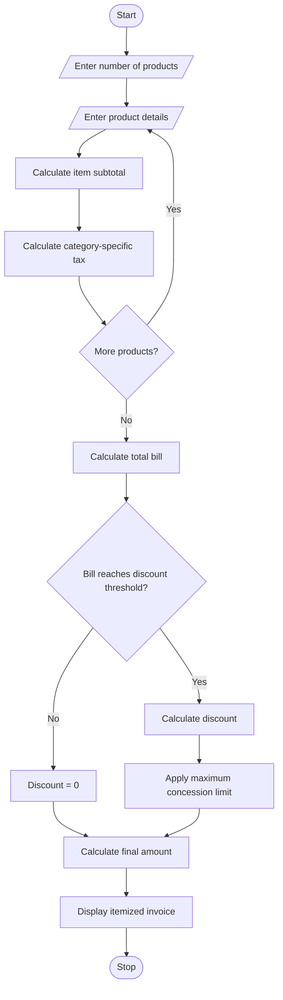

1. Problem Statement
Develop a Python program to generate a retail bill for multiple products. The program should accept product names, quantities, prices, and categories. It should calculate the total amount, apply category-specific taxes, provide discounts based on purchase amount, and ensure that the discount does not exceed the maximum concession limit. Finally, it should display an itemized invoice with product details, taxes, discounts, and the final payable amount.
# 2. Algorithm
1. Start the program.
2. Read the number of products.
3. Enter product name, category, price, and quantity.
4. Calculate the subtotal for each product.
5. Apply category-specific tax rates.
6. Calculate the total bill amount.
7. Check the discount eligibility based on the bill amount.
8. Apply the eligible discount.
9. Check the maximum concession limit.
10. Calculate the final payable amount.
11. Display the itemized invoice.
12. Stop the program.
# 3. Mermaid Flowchart

# 4. Python Source Code
print("===== RETAIL BILLING SYSTEM =====")

n = int(input("Enter number of products: "))

subtotal = 0
total_tax = 0

tax_rates = {
    "electronics": 18,
    "grocery": 5,
    "clothing": 12,
    "others": 10
}

print("\nEnter Product Details")

for i in range(n):
    print("\nProduct", i + 1)

    name = input("Product Name: ")
    category = input("Category: ").lower()
    price = float(input("Price: "))
    quantity = int(input("Quantity: "))

    if price < 0 or quantity <= 0:
        print("Invalid price or quantity!")
        continue

    rate = tax_rates.get(category, 10)

    amount = price * quantity
    tax = amount * rate / 100

    subtotal += amount
    total_tax += tax

    print("Amount:", amount)
    print("Tax:", tax)

gross_total = subtotal + total_tax

# Discount calculation
if gross_total >= 5000:
    discount = gross_total * 0.10
elif gross_total >= 3000:
    discount = gross_total * 0.05
else:
    discount = 0

# Maximum concession limit
max_discount = 1000
discount = min(discount, max_discount)

final_amount = gross_total - discount

# Display invoice
print("\n========== RETAIL INVOICE ==========")
print("Subtotal       : Rs.", round(subtotal, 2))
print("Total Tax      : Rs.", round(total_tax, 2))
print("Gross Total    : Rs.", round(gross_total, 2))
print("Discount       : Rs.", round(discount, 2))
print("------------------------------------")
print("Final Amount   : Rs.", round(final_amount, 2))
print("====================================")
print("Thank You! Visit Again.")
# 5. Sample Input
Enter number of products: 2

Product 1
Product Name: Laptop
Category: electronics
Price: 50000
Quantity: 1

Product 2
Product Name: Shirt
Category: clothing
Price: 1000
Quantity: 2
# 6. Sample Output
Product       Amount
------------------------
Laptop        Rs. 50000
Shirt         Rs.  2000
------------------------
Subtotal      Rs. 52000
Total Tax     Rs.  9240
Gross Total   Rs. 61240
Discount      Rs.  1000
------------------------
Final Amount  Rs. 60240
------------------------
Thank You!
Visit Again.
# 7. Output Calculation
Description	Amount
Laptop amount	₹50,000
Shirt amount	₹2,000
Subtotal	₹52,000
Electronics tax (18%)	₹9,000
Clothing tax (12%)	₹240
Total tax	₹9,240
Gross total	₹61,240
Discount (10%, capped)	₹1,000
Final payable amount	₹60,240
# 8. Output screen short
# 

