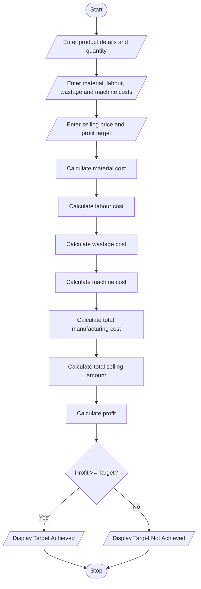

# 1. Problem Statement
Write a Python program to calculate the total manufacturing cost of a product by considering material costs, labour charges, wastage costs, and machine costs. Calculate the selling price and total profit. Check whether the production meets the specified profit target and display the final result.
# 2. Algorithm
1. Start the program.
2. Get the product name and quantity.
3. Enter the material cost per unit.
4. Enter the labour charge per unit.
5. Enter the wastage percentage.
6. Enter the machine cost per unit.
7. Enter the selling price per unit.
8. Enter the required profit target.
9. Calculate total material cost.
10. Calculate total labour cost.
11. Calculate wastage cost.
12. Calculate total machine cost.
13. Calculate total manufacturing cost.
14. Calculate total selling amount and profit.
15. Compare the profit with the target.
16. Display the manufacturing cost, selling amount, profit, and result.
17. Stop the program.
# 3. Mermaid Flowchart

# 4. Python Source Code
print("MANUFACTURING COST AND PROFIT ANALYSIS")

name = input("Enter product name: ")
qty = int(input("Enter quantity: "))

material = float(input("Enter material cost per unit: "))
labour = float(input("Enter labour charge per unit: "))
wastage = float(input("Enter wastage percentage: "))
machine = float(input("Enter machine cost per unit: "))

selling = float(input("Enter selling price per unit: "))
target = float(input("Enter profit target: "))

# Calculate costs
material_cost = material * qty
labour_cost = labour * qty
wastage_cost = material_cost * wastage / 100
machine_cost = machine * qty

total_cost = (material_cost + labour_cost +
              wastage_cost + machine_cost)

sales = selling * qty
profit = sales - total_cost

# Display invoice
print("\n------ MANUFACTURING REPORT ------")
print("Product Name:", name)
print("Quantity:", qty)
print("Material Cost:", material_cost)
print("Labour Cost:", labour_cost)
print("Wastage Cost:", wastage_cost)
print("Machine Cost:", machine_cost)
print("Total Manufacturing Cost:", total_cost)
print("Total Selling Amount:", sales)
print("Total Profit:", profit)

if profit >= target:
    print("Result: Profit Target Achieved")
else:
    print("Result: Profit Target Not Achieved")

print("----------------------------------")
# 5. Sample Input
Enter product name: Chair
Enter quantity: 100
Enter material cost per unit: 50
Enter labour charge per unit: 20
Enter wastage percentage: 5
Enter machine cost per unit: 10
Enter selling price per unit: 100
Enter profit target: 1500
# 6. Expected Output
------ MANUFACTURING REPORT ------
Product Name: Chair
Quantity: 100
Material Cost: 5000.0
Labour Cost: 2000.0
Wastage Cost: 250.0
Machine Cost: 1000.0
Total Manufacturing Cost: 8250.0
Total Selling Amount: 10000.0
Total Profit: 1750.0
Result: Profit Target Achieved
----------------------------------
# 7. Output screen short

