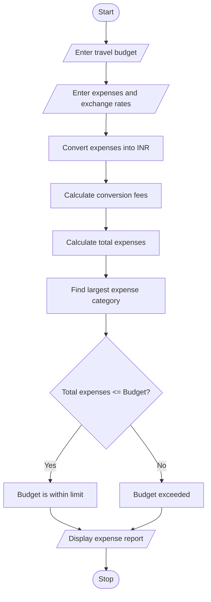

# 1. Problem Statement
Develop a Python program to analyze travel expenses in different currencies. Convert expenses into a common currency using supplied exchange rates, include conversion fees, compare total spending with the given budget, and identify the largest expense category.
# 2. Algorithm
1. Start the program.
2. Enter the travel budget in INR.
3. Enter expense categories and their amounts in different currencies.
4. Enter the exchange rate for each currency.
5. Calculate the converted amount.
6. Calculate the conversion fee.
7. Add the converted amount and fee.
8. Calculate total travel expenses.
9. Compare total expenses with the budget.
10. Identify the largest expense category.
11. Display the final report.
12. Stop the program.
# 3. Mermaid Flowchart

# 4. Python Source Code
print("MULTI-CURRENCY TRAVEL BUDGET ANALYSIS")

budget = 100000
fee_rate = 2

expenses = {
    "Hotel": (300, 83.5),
    "Food": (200, 90),
    "Transport": (100, 105),
    "Shopping": (250, 83.5)
}

total = 0
largest_category = ""
largest_expense = 0

print("\nExpense Details:")
print("----------------------------------")

for category, (amount, rate) in expenses.items():
    converted = amount * rate
    fee = converted * fee_rate / 100
    final_amount = converted + fee

    total += final_amount

    if final_amount > largest_expense:
        largest_expense = final_amount
        largest_category = category

    print(category, "=", round(final_amount, 2), "INR")

print("----------------------------------")
print("Total Expenses:", round(total, 2), "INR")
print("Travel Budget:", budget, "INR")

if total <= budget:
    print("Budget Status: Within Budget")
else:
    print("Budget Status: Budget Exceeded")

print("Largest Expense:", largest_category)
# 5. Sample Input
Category	Amount	Exchange rate
Hotel	300 USD	₹83.50
Food	200 EUR	₹90
Transport	100 GBP	₹105
Shopping	250 USD	₹83.50
# 6. Sample Output
MULTI-CURRENCY TRAVEL BUDGET ANALYSIS

Expense Details:
----------------------------------
Hotel = 25551.0 INR
Food = 18360.0 INR
Transport = 10710.0 INR
Shopping = 21292.5 INR
----------------------------------
Total Expenses: 75913.5 INR
Travel Budget: 100000 INR
Budget Status: Within Budget
Largest Expense: Hotel
# 7.Output screenshot
