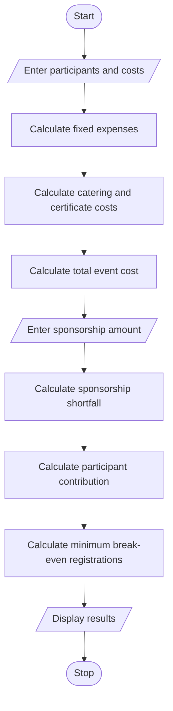

# 1. Problem Statement
Develop a Python program for Campus Event Financial Planning. Calculate the total expenses for venue, equipment, catering, transport, and certificates. Determine the sponsorship shortfall, participant contribution, and minimum number of registrations required to break even.
# 2. Algorithm
1. Start the program.
2. Get the number of participants.
3. Enter venue, equipment, catering, transport, and certificate costs.
4. Calculate fixed and variable expenses.
5. Calculate the total event cost.
6. Enter the sponsorship amount.
7. Calculate the sponsorship shortfall.
8. Calculate the contribution required from each participant.
9. Calculate the minimum registration count needed to break even.
10. Display all financial details.
11. Stop the program.
# 3. Mermaid Flowchart

# 4. Python Source Code

import math

print("CAMPUS EVENT FINANCIAL PLANNING")
print("--------------------------------")

# Input details
participants = int(input("Enter number of participants: "))

venue = float(input("Enter venue cost: "))
equipment = float(input("Enter equipment cost: "))
catering = float(input("Enter catering cost per participant: "))
transport = float(input("Enter transport cost: "))
certificate = float(input("Enter certificate cost per participant: "))

sponsorship = float(input("Enter sponsorship amount: "))
registration_fee = float(input("Enter registration fee per participant: "))

# Calculate expenses
fixed_cost = venue + equipment + transport
variable_cost = (catering + certificate) * participants

total_cost = fixed_cost + variable_cost

# Sponsorship shortfall
shortfall = max(0, total_cost - sponsorship)

# Participant contribution
contribution = shortfall / participants if participants > 0 else 0

# Break-even registration count
balance = registration_fee - catering - certificate

if balance > 0:
    minimum_registrations = max(
        0, math.ceil((fixed_cost - sponsorship) / balance)
    )
else:
    minimum_registrations = "Not possible"

# Display results
print("\n------ EVENT FINANCIAL REPORT ------")
print("Fixed Cost:", fixed_cost)
print("Variable Cost:", variable_cost)
print("Total Event Cost:", total_cost)
print("Sponsorship:", sponsorship)
print("Sponsorship Shortfall:", shortfall)
print("Contribution per Participant:", round(contribution, 2))
print("Minimum Registrations for Break-even:",
      minimum_registrations)

if balance > 0:
    print("Break-even Status: Achievable")
else:
    print("Break-even Status: Not achievable")
# 5. Sample Input
Input	Value
Participants	60
Venue cost	₹12,000
Equipment cost	₹5,000
Catering/person	₹250
Transport cost	₹3,000
Certificate/person	₹40
Sponsorship	₹10,000
Registration fee/person	₹500
# 6. Sample Output
CAMPUS EVENT FINANCIAL PLANNING
--------------------------------
Enter number of participants: 60
Enter venue cost: 12000
Enter equipment cost: 5000
Enter catering cost per participant: 250
Enter transport cost: 3000
Enter certificate cost per participant: 40
Enter sponsorship amount: 10000
Enter registration fee per participant: 500

------ EVENT FINANCIAL REPORT ------
Fixed Cost: 20000.0
Variable Cost: 17400.0
Total Event Cost: 37400.0
Sponsorship: 10000.0
Sponsorship Shortfall: 27400.0
Contribution per Participant: 456.67
Minimum Registrations for Break-even: 48
Break-even Status: Achievable
# 7. Output Explanation
- Total Event Cost: ₹37,400
- Sponsorship Shortfall: ₹27,400
- Participant Contribution: ₹456.67
- Minimum Registrations: 48 participants
- Break-even Status: Achievable
