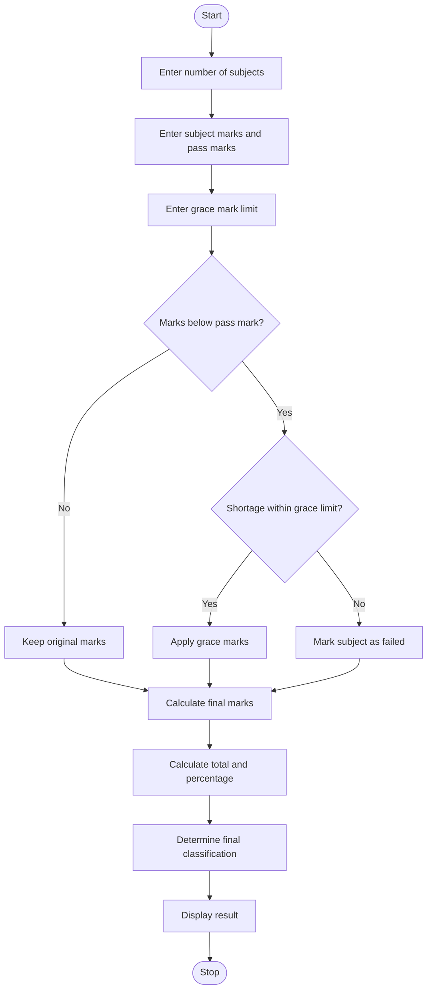

# 1. Problem Statement
Write a Python program to process students' marks in multiple subjects. Apply subject-wise passing criteria and a specified grace-mark policy. Calculate the final marks without exceeding maximum marks and generate the student's final result classification based on the total percentage.
# 2. Algorithm
1. Start the program.
2. Read the number of subjects.
3. Enter the subject name, maximum marks, obtained marks and pass marks.
4. Enter the maximum grace marks allowed.
5. Check whether the obtained marks meet the passing criteria.
6. If a student fails by a mark difference within the grace limit, apply grace marks.
7. Ensure the final marks do not exceed maximum marks.
8. Calculate total marks and percentage.
9. Determine the final result:
   - 75% and above – Distinction.
   - 60% to 74.99% – First Class.
   - 50% to 59.99% – Second Class.
   - 40% to 49.99% – Pass.
   - Below 40% or any subject failed – Fail.
10. Display the subject-wise marks and final classification.
11. Stop.
# 3. Mermaid Flowchart

# 4. Python Source Code

print("EXAMINATION RESULT AND GRACE-MARK VALIDATION")
print("--------------------------------------------")

n = int(input("Enter number of subjects: "))
grace_limit = int(input("Enter maximum grace marks: "))

total = 0
maximum_total = 0
all_pass = True

for i in range(n):
    print("\nSubject", i + 1)

    name = input("Enter subject name: ")
    maximum = int(input("Enter maximum marks: "))
    marks = int(input("Enter obtained marks: "))
    pass_mark = int(input("Enter pass marks: "))

    if maximum <= 0 or pass_mark < 0 or pass_mark > maximum:
        print("Invalid subject details")
        raise SystemExit

    if marks < 0 or marks > maximum:
        print("Invalid obtained marks")
        raise SystemExit

    grace = 0

    if marks < pass_mark:
        shortage = pass_mark - marks

        if shortage <= grace_limit:
            grace = shortage
            marks = min(marks + grace, maximum)
        else:
            all_pass = False

    print("Subject:", name)
    print("Grace marks:", grace)
    print("Final marks:", marks)

    if marks < pass_mark:
        all_pass = False

    total += marks
    maximum_total += maximum

percentage = (total / maximum_total) * 100

print("\n---------- FINAL RESULT ----------")
print("Total Marks:", total, "/", maximum_total)
print("Percentage:", round(percentage, 2), "%")

if not all_pass:
    result = "FAIL"
elif percentage >= 75:
    result = "DISTINCTION"
elif percentage >= 60:
    result = "FIRST CLASS"
elif percentage >= 50:
    result = "SECOND CLASS"
elif percentage >= 40:
    result = "PASS"
else:
    result = "FAIL"

print("Final Classification:", result)
# 5. Sample Input
Enter number of subjects: 3
Enter maximum grace marks: 5

Subject 1
Enter subject name: Python
Enter maximum marks: 100
Enter obtained marks: 38
Enter pass marks: 40

Subject 2
Enter subject name: Maths
Enter maximum marks: 100
Enter obtained marks: 75
Enter pass marks: 40

Subject 3
Enter subject name: English
Enter maximum marks: 100
Enter obtained marks: 80
Enter pass marks: 40
# 6. Expected Output
EXAMINATION RESULT AND GRACE-MARK VALIDATION

Subject: Python
Grace marks: 2
Final marks: 40

Subject: Maths
Grace marks: 0
Final marks: 75

Subject: English
Grace marks: 0
Final marks: 80

---------- FINAL RESULT ----------
Total Marks: 195 / 300
Percentage: 65.0 %
Final Classification: FIRST CLASS
# 7.Output screenshot
